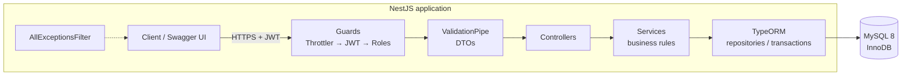
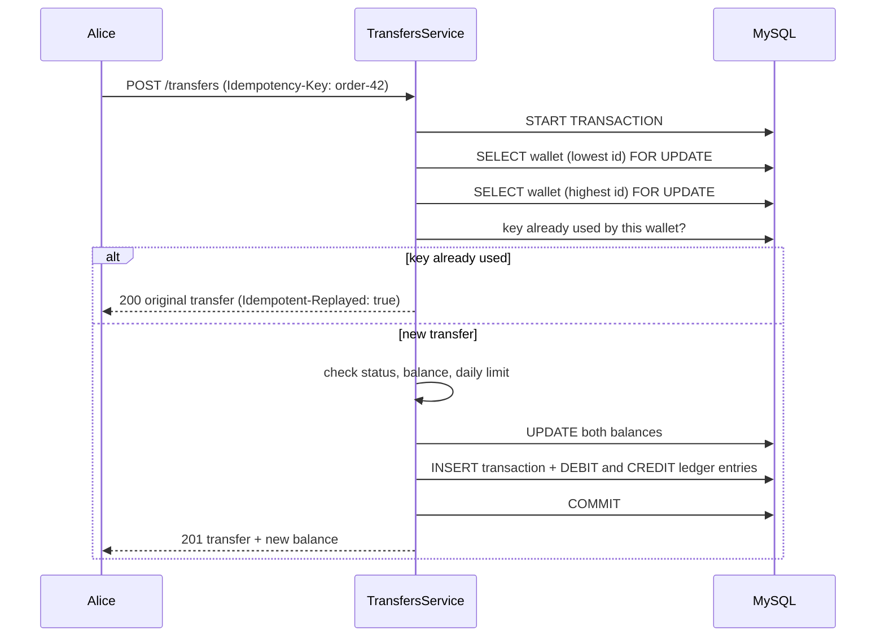
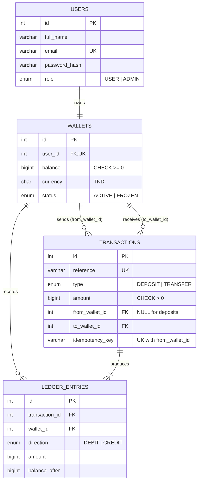

# PayLite — Wallet & P2P Transfer API

[](https://github.com/bilel-hmem/paylite-wallet-api/actions/workflows/ci.yml)


A digital wallet backend where users top up their balance and send money to each other — built so that **balances can never go wrong**, even under concurrent requests and network retries.

> **Live API docs:** _coming soon (deployed with [paylite-infra](https://github.com/bilel-hmem/paylite-infra))_

## Why this project

Payment apps must guarantee three things:

1. **Money is never created or lost** → every movement is written to a double-entry ledger that can be reconciled.
2. **A retried request never pays twice** → transfers accept an `Idempotency-Key` header.
3. **Two simultaneous transfers cannot overdraw a wallet** → wallet rows are locked (`SELECT … FOR UPDATE`) inside one DB transaction.

Point 3 is proven by an e2e test that fires **20 transfers at the same time** against a real MySQL: exactly 10 succeed, the balance ends at exactly 0, and the ledger still reconciles.

## Features

- Register / login with JWT (bcrypt-hashed passwords), roles `USER` and `ADMIN`
- A TND wallet is created atomically with every account
- Simulated top-up, P2P transfer by email, optional `Idempotency-Key`
- Business rules: no overdraft, no self-transfer, frozen wallets blocked, daily limit (2,000 TND by default)
- Transaction history with filters (`type`, `direction`, date range, amount range) and pagination
- Admin: list all transactions and wallets, freeze / unfreeze a wallet, ledger reconciliation report
- Consistent error format, input validation, rate limiting, security headers, health check
- Swagger / OpenAPI docs at `/docs`

## Architecture



```
src/
├── common/          # decorators, guards, exception filter, pagination, money helpers
├── config/          # environment validation (Joi): the app refuses to start if .env is wrong
├── database/        # data source for the CLI, migrations, seed script
└── modules/
    ├── auth/        # register, login, JWT strategy
    ├── users/       # User entity
    ├── wallets/     # balance, deposits, admin wallet management
    ├── transfers/   # P2P transfers (locking, idempotency, ledger)
    ├── transactions/# history, ledger entities
    ├── admin/       # reconciliation
    └── health/      # /health for Docker and deployments
test/                # e2e tests against a real MySQL
```

### How a transfer works



## Data model

All amounts are **integers in millimes** (1 TND = 1000 millimes), stored as `BIGINT`. No floating point anywhere.



## Tech stack

| Layer | Choice |
|---|---|
| Runtime / framework | Node.js 22, NestJS 11, TypeScript (strict) |
| Database | MySQL 8, TypeORM 0.3 with migrations (`synchronize` is off) |
| Auth | Passport JWT, bcrypt, role-based guards |
| Validation & docs | class-validator, class-transformer, Joi (env), Swagger / OpenAPI |
| Security | helmet, @nestjs/throttler, global exception filter |
| Tests | Jest, Supertest (e2e on a real MySQL) |
| Delivery | Docker (multi-stage, non-root), docker compose, GitHub Actions |

## Getting started

**Requirements:** Node.js 22+, Docker (for MySQL).

```bash
git clone https://github.com/bilel-hmem/paylite-wallet-api.git
cd paylite-wallet-api
npm ci
cp .env.example .env

docker compose up -d mysql     # MySQL 8 (also creates the paylite_test database)
npm run migration:run          # create the tables
npm run seed                   # demo accounts below
npm run start:dev              # http://localhost:3000/docs
```

Or run everything in containers: `docker compose up -d --build` (migrations run automatically).

### Demo accounts (created by `npm run seed`)

| Email | Password | Role | Balance |
|---|---|---|---|
| `admin@paylite.tn` | `Passw0rd!` | ADMIN | 0 TND |
| `alice@paylite.tn` | `Passw0rd!` | USER | 500 TND |
| `bob@paylite.tn` | `Passw0rd!` | USER | 150 TND |

## API examples

Base URL: `http://localhost:3000/api/v1`

```bash
# Log in
TOKEN=$(curl -s -X POST http://localhost:3000/api/v1/auth/login \
  -H "Content-Type: application/json" \
  -d '{"email":"alice@paylite.tn","password":"Passw0rd!"}' | jq -r .accessToken)

# Check the balance
curl -s http://localhost:3000/api/v1/wallets/me -H "Authorization: Bearer $TOKEN"
# {"id":2,"balance":500000,"balanceFormatted":"500.000 TND","currency":"TND","status":"ACTIVE"}

# Send 25 TND to Bob — safe to retry thanks to the Idempotency-Key
curl -s -X POST http://localhost:3000/api/v1/transfers \
  -H "Authorization: Bearer $TOKEN" -H "Content-Type: application/json" \
  -H "Idempotency-Key: dinner-2026-11-23" \
  -d '{"recipientEmail":"bob@paylite.tn","amount":25000,"description":"Dinner"}'

# Last 10 transfers sent
curl -s "http://localhost:3000/api/v1/transactions?direction=OUT&limit=10" \
  -H "Authorization: Bearer $TOKEN"
```

| Method | Endpoint | Access | Description |
|---|---|---|---|
| POST | `/auth/register` | public | Create an account + wallet |
| POST | `/auth/login` | public | Get a JWT (10 attempts/min) |
| GET | `/auth/me` | user | Profile and wallet |
| GET | `/wallets/me` | user | Balance and status |
| POST | `/wallets/me/deposits` | user | Simulated top-up |
| POST | `/transfers` | user | P2P transfer (`Idempotency-Key` header) |
| GET | `/transactions` | user | History: `type`, `direction`, `from`, `to`, `minAmount`, `maxAmount`, `page`, `limit`, `order` |
| GET | `/transactions/:reference` | user | One of your transactions |
| GET | `/admin/transactions` | admin | All transactions (+ `walletId` filter) |
| GET | `/admin/wallets` | admin | All wallets (`status`, `email`) |
| PATCH | `/admin/wallets/:id/status` | admin | Freeze / unfreeze |
| GET | `/admin/reconcile` | admin | Balance vs ledger check |
| GET | `/health` | public | Liveness + DB ping |

Every error has the same shape:

```json
{
  "statusCode": 422,
  "error": "Unprocessable Entity",
  "message": "Insufficient funds",
  "path": "/api/v1/transfers",
  "timestamp": "2026-11-23T10:15:02.118Z"
}
```

## Tests

```bash
npm test              # unit tests (business rules, services, guards, filter)
npm run test:cov      # with coverage
npm run test:e2e      # e2e: needs MySQL running (docker compose up -d mysql)
```

The e2e suite uses `.env.test`, applies the migrations to `paylite_test` first, and refuses to run on a database whose name does not end in `_test`. Highlights:

- `concurrency.e2e-spec.ts` — 20 simultaneous transfers never overdraw a wallet; 5 simultaneous requests with the same `Idempotency-Key` create exactly one transfer; two users paying each other at once do not deadlock.
- `transfers.e2e-spec.ts` — balances, validation, idempotent replay, history filters, ownership (404 on other users' transactions), admin freeze, reconciliation.
- `auth.e2e-spec.ts` — registration, duplicate email, validation messages, login, JWT guard.

## Design decisions

- **Integer millimes, not decimals or floats.** `0.1 + 0.2 !== 0.3` in JavaScript; integers make every sum exact. MySQL returns `BIGINT` as a string, so a small TypeORM transformer converts it.
- **Pessimistic row locks, lowest id first.** Optimistic locking would make concurrent transfers fail and retry; locking the two rows makes them queue instead. Locking in a fixed order means Alice→Bob and Bob→Alice can never deadlock.
- **Idempotency checked after the lock.** The sender's row lock serialises its transfers, so two retries of the same request cannot both pass the check. A unique index on `(from_wallet_id, idempotency_key)` is the final guard.
- **Double-entry ledger + reconciliation.** Balances are a cache of the ledger; `GET /admin/reconcile` proves they agree.
- **Defence in depth in the schema.** `CHECK (balance >= 0)` means even a bug in the code cannot store a negative balance.
- **404 instead of 403 for other people's data**, so the API does not reveal which references exist. Login gives the same error (and takes the same time) for an unknown email and a wrong password.

## Migrations

```bash
npm run migration:generate -- src/database/migrations/AddSomething   # after changing an entity
npm run migration:run
npm run migration:revert
```

## Future improvements

- Refresh tokens with rotation, and account lockout after failed logins
- Real top-ups through a payment provider sandbox (webhooks + signature check)
- Outbox pattern to publish `transfer.completed` events (notifications, analytics)
- Multi-currency wallets with exchange rates
- Monthly PDF statements generated from the ledger

## License

[MIT](LICENSE)
